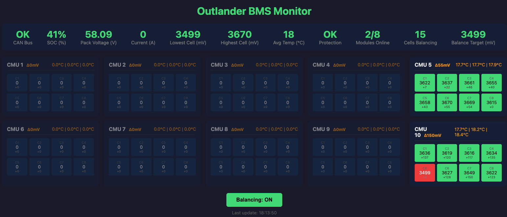

# Outlander PHEV BMS Reader for T-2Can

This is standalone PlatformIO firmware for the LilyGo T-2Can board (ESP32-S3).
It reads cell voltages and temperatures from Mitsubishi Outlander PHEV battery
modules over CAN and provides monitoring, balancing, MQTT telemetry, and a
physical safety permissive for DIY home energy storage.

## Current runtime contract (verified 16 October 2026)

The current firmware is a standalone CMU monitoring/safety controller. It reads CMU CAN data, controls balancing, publishes MQTT telemetry, and drives one physical permissive: GPIO15 `BATTERY_SAFE_TO_USE` (active HIGH). GPIO15 goes LOW for high temperature, no CAN data for 10 seconds, a selected CMU missing for 10 seconds, any cell at or above 4.20 V, or any cell at or below 2.80 V. Temperature and communication trips cannot be overridden. The external breaker interface must open when this normally-HIGH permissive goes LOW.

This firmware does not read amperage or perform coulomb counting. It calculates
cell-voltage-derived charge/discharge current ceilings for PowerWall-Gateway,
but does not control inverter work modes, run ESS contactor sequencing, or emit
inverter-side SIMPBMS/FoxESS frames. It has no Battery-Emulator application
dependency. MQTT is its current external interface. A future dedicated framed
serial sender will feed the standalone gateway; it is not implemented yet. SOC
is voltage-derived telemetry/fallback data. The live device is at
`http://192.168.2.99/` (13 October 2026).

### 13 October 2026: highest-cell voltage SOC

The BMS voltage gauge now uses the highest selected cell. Its 100% reference is
4.200 V; rounding and the median filter cannot show 100% below the live threshold.
Reaching the threshold is displayed immediately, and falling below it clears
100% immediately. Below full, the existing median/upward-slew filter remains.
This is a voltage gauge, **not measured stored-energy SOC**. FoxGW sends its
separate energy-counted operational SOC to the inverter.

The live curve's last point is changed from `4100:100` to `4200:100`, retaining
all lower points. For 80 selected cells this advertises a 336.0 V design maximum
(minimum unchanged at 256.0 V). The design maximum is not a charging target.
The existing normal taper is unchanged: charge full/reduced/stop at
4.050/4.140/4.150 V, with 13/2 A full/reduced current at deployment preflight.
Consequently normal taper can stop charging before this gauge reaches 100%.

GPIO15 still trips at **>=4200 mV**, not 4201 mV, following the user's final
clarification. Low voltage, temperature, communications protection, and the
existing supervised-override mechanism are unchanged. A 1 mV display increment
must not be interpreted as proof of 1 mV absolute measurement accuracy.
See [deployment record](docs/2026-10-13-highest-cell-soc.md).

The 16 October 02:53 BST `/api/summary` readback reported 10 expected CMUs
(11 physically observed, including an unselected module), a
highest selected cell of 3976 mV, a lowest of 3970 mV, BMS voltage SOC 74%,
`socVoltageSource=highest_cell`, a 4200 mV full reference and 4200 mV
overvoltage trip. Protection was `OK`, CAN data was fresh (4 ms), GPIO15
reported HIGH, and no supervised override was active. The saved curve ends at `4200:100`; the charge taper is
4.050/4.140/4.150 V at 13/2 A and the discharge taper is
3.600/3.500/3.300 V at 11/1 A. This API readback does not prove the exact
installed binary or physical breaker operation.

Balancing-cell count MQTT telemetry is deliberately published at a 10-second interval. Per-CMU maximum temperature topics and the overall pack maximum temperature topic are published with the other BMS telemetry.

## Features

### Current Capabilities

- **CAN Bus Communication**: Both CAN-A (MCP2515) and CAN-B (TWAI) are dedicated CMU buses, reading up to 20 Outlander PHEV CMUs across isolated segments. MQTT is the current external transport; this firmware does not emit Battery Emulator or inverter CAN traffic.
- **Cell Voltage Monitoring**: Tracks 8 cells per configured CMU
- **Temperature Monitoring**: 3 temperature sensors per CMU
- **Cell Balancing Control**: Uses the eighth-lowest valid cell voltage, preserving the lowest seven cells from discharge
- **Web Dashboard**: Real-time monitoring via WiFi
- **Serial/Web Command Parity**: Every serial command is available through `POST /api/command`; `GET /api/help` returns the mapping
- **Fail-safe physical output**: GPIO15 `BATTERY_SAFE_TO_USE`, active HIGH only while the BMS is safe
- **Temperature telemetry**: Per-CMU and overall maximum temperature MQTT topics
- **CAN diagnostics**: MCP2515/TWAI status, error counters, and message counters in serial and web output

## Hardware Requirements

- **LilyGO T-2Can board** (ESP32-S3)
- **Outlander PHEV battery modules** with CMUs
- **CAN bus connection** to the battery modules

## Setup Instructions

### 1. Install PlatformIO

Follow the [T-2Can PlatformIO setup](https://github.com/Xinyuan-LilyGO/T-2Can?tab=readme-ov-file#platformio)

### 2. Configure WiFi

```bash
cp .config.h.template .config.h
# Edit .config.h and set your WiFi credentials
```

### 3. Build and Upload

```bash
pio run -t upload
```

### 4. Access the Dashboard

Once connected to WiFi, the serial console will display the IP address. Navigate to `http://<ip-address>/` in your browser to see the web dashboard.

### OTA Updates

The first OTA-capable firmware must be installed over USB. Later updates can be uploaded over WiFi:

```bash
pio run -e outlander_bms_ota -t upload
```

The OTA environment defaults to the currently identified BMS at
`192.168.2.99`; confirm device identity before uploading and use
`--upload-port <ip-or-hostname>` if its address changes. OTA is authenticated
with `OTA_PASSWORD` from the ignored `.config.h`, falling back to the private
`WIFI_PASSWORD` when no separate OTA password is defined. The OTA listener is
restored automatically after a WiFi reconnect.

## Web Dashboard

The web interface provides real-time monitoring of:
- State of Charge (SOC) percentage
- Pack voltage
- Pack-wide cell-voltage delta
- Per-module voltage totals for each complete eight-cell CMU
- Overall maximum temperature and per-module maximum temperatures
- Individual cell voltages (color-coded)
- Temperature readings
- Cell balancing status
- Protection system status
- CAN bus connectivity
- GPIO15 battery-safe-to-use state and supervised-override timer
- Collapsible Bus A/Bus B sections when no CMUs are selected
- Confirmed reboot control with visible restart feedback
- Full report, detailed statistics, CAN diagnostics, debug toggle, balancing toggle, supervised voltage override, and expected-CMU mask controls



## Serial commands and web equivalents

Connect via USB serial (115200 baud) and use these commands:

- `b` - Toggle cell balancing on/off
- `d` - Toggle debug mode (shows raw CAN frames)
- `r` - Show the full BMS report
- `o` - Enable the ten-minute supervised voltage-recovery override (refused when CAN/temperature is unsafe)
- `O` - Cancel the supervised override
- `s` - Show detailed module statistics
- `c` - Show MCP2515/TWAI CAN diagnostics
- `A` - Set the expected Bus A CMU mask, entered as hexadecimal
- `B` - Set the expected Bus B CMU mask, entered as hexadecimal
- `h` or `?` - Show help

The dashboard exposes these through `POST /api/command` with form field `command`. For `A` and `B`, add `mask=HEX`; for example `command=B&mask=3FF`. `GET /api/help` returns the same mapping. The existing `/api/summary`, `/api/module/N`, `/api/balancing`, `/api/config`, and `/api/reboot` endpoints remain available.

The current taper is persisted in NVS and can be replaced atomically without a
firmware rebuild. Values are charge full/reduced/stop voltage, charge
full/reduced current, then the equivalent discharge values, in volts and amps:

```bash
curl -X POST http://outlander-bms.local/api/config \
  --data-urlencode 'currentTaper=4.050,4.140,4.150,13.0,2.0,3.600,3.500,3.300,11.0,1.0'
```

`GET /api/summary` reports both the persisted curve and the live charge and
discharge limits. Invalid, reversed, out-of-range, or partial curves are
rejected without changing the active settings.

Home Assistant MQTT Discovery also creates ten configuration `number` entities
on the Outlander BMS device, one for each taper voltage/current parameter, plus
a `switch` named **Balancing**. Number commands are applied to a copy of the
complete curve and persisted only when the resulting curve remains valid; a
rejected command is answered with the unchanged authoritative value. The
balancing switch controls the existing runtime flag and deliberately starts
OFF after a reboot or OTA update. Command messages are not retained, preventing
an old balancing request from being replayed when the BMS reconnects.

The controls use `outlander_bms/control/current_taper/<parameter>/set` and
`outlander_bms/control/balancing/set`; their retained state topics end in
`/state`. The firmware subscribes to `outlander_bms/control/#` after each MQTT
connection.

The BMS voltage SOC gauge uses a configurable monotonic piecewise curve. Each
point is `cell_millivolts:percent`; voltages must increase and percentages may
increase or stay flat. It currently uses the highest selected cell. The
deployed curve is:

```bash
curl -X POST http://outlander-bms.local/api/config \
  --data-urlencode 'socCurvePoints=3200:0,3440:10,3695:15,3735:20,3800:30,3855:40,3895:50,3920:60,3965:70,3990:80,4010:90,4200:100'
```

The historical `socCurve=lowMv,lowPercent,highMv,highPercent` form remains
accepted and installs a two-point curve. MQTT and `/api/summary` expose the
unfiltered mapped SOC, the 15-second median cell voltage, and the active curve
for diagnosis. Brief downward voltage sag is median-filtered; upward recovery
is limited to one percentage point per 30 seconds. Raw cell extrema still own
protection and current taper.

## Current configuration reference

The active settings are defined in `src/bms_data.h` and persisted in NVS. They
include the high-temperature trip, voltage-derived SOC curve, expected-CMU
masks, and the normal-use current taper. Emergency cell-voltage stops and the
GPIO15 permissive remain fixed in `src/protection.cpp`.

Charge current is governed only by the highest selected cell. The 16 October
live settings allow up to 13 A through 4.050 V, taper to 2 A at 4.140 V, and
stop at 4.150 V. Discharge is governed only by the lowest selected cell: up to
11 A at and above 3.600 V, taper to 1 A at 3.500 V, and stop at 3.300 V.
The BMS publishes the two
limits atomically on `outlander_bms/pack/current_limits`; PowerWall-Gateway
turns them into the FoxESS CAN current ceilings.

On startup, the firmware migrates the historical 4.00 V voltage-SOC endpoint
to 4.05 V. An existing 4.05 V endpoint remains unchanged. The 4.20 V emergency
cell-voltage stop remains a separate absolute safety ceiling and is never a
normal charging target. The 13 October live configuration uses 4.20 V as its
SOC/design reference only; normal charging is still stopped by the independent
taper below that reference.

## Project Structure

```
./
├── src/
│   ├── main.cpp           # Entry point, main loop
│   ├── config.h           # Hardware pins, constants
│   ├── bms_data.h/cpp     # Data structures, global state
│   ├── can_handler.h/cpp  # CAN bus communication
│   ├── serial_menu.h/cpp  # Serial console interface
│   ├── wifi_handler.h/cpp # WiFi management
│   ├── web_server.h/cpp   # Web dashboard
│   ├── soc_calc.h/cpp     # Voltage-derived SOC
│   ├── current_taper.h/cpp # Cell-extrema current ceilings
│   └── protection.h/cpp   # GPIO15 safety permissive
├── test/
│   ├── test_main.cpp      # Test entry point
│   ├── test_bms_data.cpp  # BMS data tests
│   ├── test_soc_calc.cpp  # SOC calculation tests
│   ├── test_protection.cpp # Protection system tests
│   ├── test_safety_critical.cpp # Safety critical tests
│   └── mocks/             # Mock Arduino/Preferences for native tests
├── platformio.ini         # Build configuration
├── README.md              # This file
└── AGENTS.md              # Development notes

```

## Status

✅ **Working**: CAN communication, voltage/temp reading, MQTT telemetry, web dashboard, serial interface, and web command bridge
✅ **Local verification**: 46/46 native tests and the ESP32-S3 OTA environment build passed on 16 October 2026
⚠️ **Supervised**: GPIO15 safety permissive is deployed; physical breaker-trip cases still require end-to-end testing
⚠️ **Deployment provenance**: the highest-cell gauge was verified after the 13 October OTA and remains visible in the 16 October live API; the installed binary is not proven byte-for-byte from this checkout
⚠️ **Repository metadata**: The GitHub repository is public and still marked as a fork of `Tom-evnut/OutlanderPHEVBMS`, although the local upstream remote and inherited firmware were removed
❌ **Intentionally absent**: amperage input, coulomb counting, ESS contactor control, and inverter-side SIMPBMS transmitter

## Remaining work

1. Physically prove GPIO15 LOW through the installed SSR/GEYA/V9 breaker chain for every fault and power-loss case.
2. Verify loss-of-either-bus behavior with all 10 selected modules.
3. Implement and bench-test the framed serial sender after the T-CAN485 receiver contract is ready.
4. Record the exact source commit and firmware hash at the next OTA deployment.

## More Information

- See `AGENTS.md` for detailed development notes, hardware specifications, and CAN protocol documentation.
- See `docs/REMOTE_LOGGING_PLAN.md` for the remote logging plan.

## Hardware

- LilyGO T-2Can
